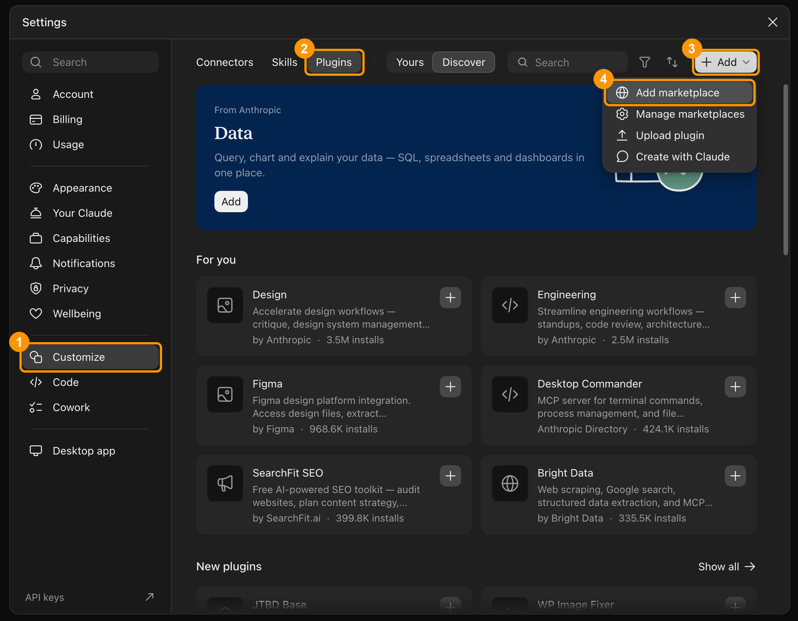
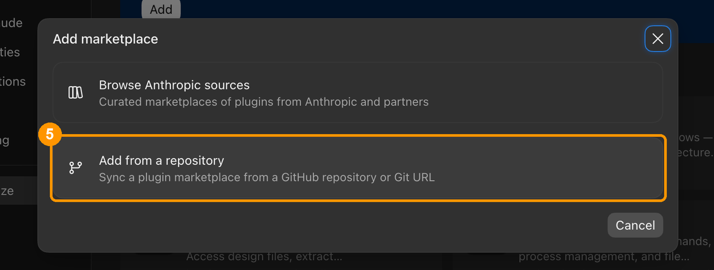
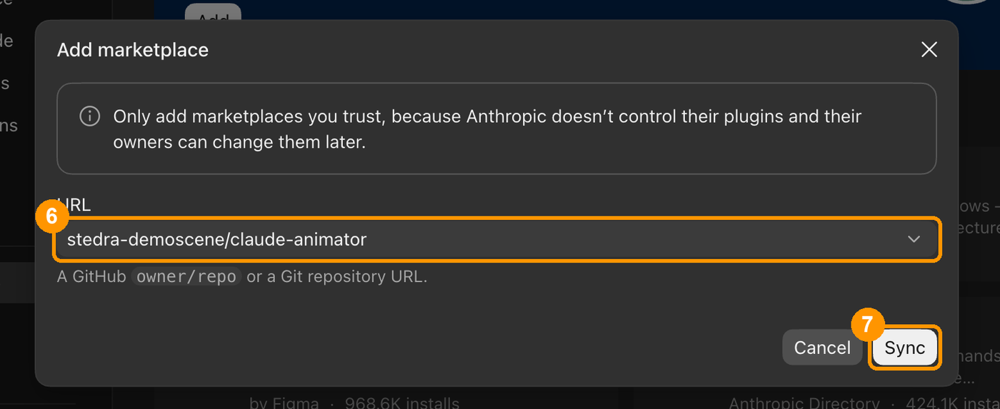
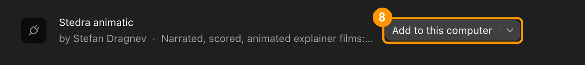
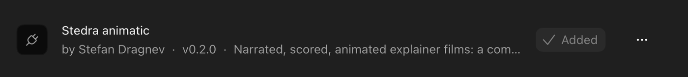

# stedra-animatic

A Claude Code skill for making a narrated, scored, animated explainer film with Claude. From your first prompt it
builds a complete **animatic** in about 15 minutes: picture, on-screen captions, a scratch voice, a temp score and sound
effects, all playing live in Chrome. Then you and Claude upgrade one layer at a time: script, voice, score, polish. The
parts are Motion Canvas for picture, a single `events.json` cue sheet from forced alignment of the voice, a score on the
same clock, and an ffmpeg mux to 1080p60. You direct and Claude builds.

## Prerequisites

macOS, Linux or Windows 10/11, Claude Code, an internet connection and Chrome. Package manager: Homebrew (macOS), apt
(Linux) or winget (built into Windows). The skill installs the rest (Node, Motion Canvas, ffmpeg, `uv` and Python, a
text-to-speech model, an aligner), shows you the plan and the sizes first, and waits for your yes. Big downloads (sample
library, a heavier voice model) wait until the pass that needs them.
On Windows, Git Bash is the usual Claude Code shell and PowerShell works too. The skill checks that each tool actually
runs, because `python` on a fresh Windows is often a Store stub.

## Install

It's a Claude Code plugin. It works in the **Code tab of the Claude Desktop app** and in the `claude` terminal app.

### Install in Claude Desktop (no terminal)

1. Open **Settings**: press <kbd>⌘</kbd> + <kbd>,</kbd> on a Mac or <kbd>Ctrl</kbd> + <kbd>,</kbd> on Windows. Go to **Customize** (1), open the **Plugins** tab (2), click
   **+ Add** (3) and choose **Add marketplace** (4).

   

2. Choose **Add from a repository** (5).

   

3. Type `stedra-demoscene/claude-animator` into the URL box (6) and click **Sync** (7).

   

4. Find **Stedra animatic** in the list and click **Add to this computer** (8).

   

   When it shows **Added**, you're done.

   

5. Close Settings, open the **Code** tab, pick an empty folder for your film, and paste a brief (see
   [Your first film](#your-first-film-a-sales-onboarding-demo)).

**Shortcut in a Code session:** type these two lines into the prompt box, one at a time:

```
/plugin marketplace add stedra-demoscene/claude-animator
/plugin install stedra-animatic@stedra-animatic
```

**Terminal:**

```bash
claude plugin marketplace add stedra-demoscene/claude-animator
claude plugin install stedra-animatic@stedra-animatic
```

Then make an empty folder for your film, open it in Claude Code, and paste a brief (see below). The skill triggers when
you ask for an animated explainer or demo video with narration and music.

**Before the first film, expect some setup.** Claude installs Node, ffmpeg, Python tools and a voice model, and asks you
to approve each command. On Windows you may need Git for Windows first, and on macOS Homebrew. If a step needs your
password or a terminal, Claude tells you exactly what to paste.

## What it installs and downloads

Claude runs a read-only environment check (`check_env.sh`, or `check_env.ps1` on Windows), then proposes a plan.

- **For the animatic:** Node and Motion Canvas (MIT), ffmpeg, `uv` with Python in a project-local venv, **Kokoro-82M**
  (Apache-2.0, about 350 MB) for the scratch voice, and torchaudio for forced alignment (heavy, with a lighter fallback).
  The temp score and sound effects are synthesized in Python. No large downloads.
- **Later, only when you reach that pass:** a final synthetic voice (Chatterbox, MIT, heavier) if you choose it, and for
  the real score FluidSynth or sfizz plus an orchestral sample library (CC0 VSCO-2 Community Edition, about 1 GB),
  downloaded into `~/.cache/stedra-animatic`, never into your repo.

Claude rechecks model licenses at install time and avoids non-commercial weights, because many users are businesses.
It writes `animator.config.json` (tool paths and the sample dir) so later sessions skip the setup.

## Live preview, not renders

"Preview" always means the Motion Canvas editor running in Chrome, with your audio loaded and hot reload on. Claude never
encodes a video just to show you something. It exports only a review reel you ask for, and the final.

## Your first film: a sales onboarding demo

Write the prompt like a creative brief to a crew: the topic, the audience, the beat it must land. Paste something
like this:

```
Make an animated explainer film for new customers of Ledgerly, invoicing software for small shops.
The viewers are shop owners who just signed up and are watching alone on a laptop.
Open on the old way: Monday morning, eleven invoices, a spreadsheet from 2019. Then the same invoice in Ledgerly
in under a minute. The beat it must land: "your first invoice goes out on day one, in three clicks".
Dry humor, no hype. Light music, nothing busy. The product demo should be scripted footage, not live.
```

What happens next:

1. **Expectations and setup.** Claude says what to expect (a draft in minutes, a finished film in days), runs the
   environment check, shows an install plan with sizes, and waits for your yes.
2. **The animatic, in about 15 minutes.** Claude writes `brief.md` (its assumptions on top, for you to correct) and the
   script, makes a scratch voice with Kokoro, aligns it, generates `events.json`, builds draft scenes with captions,
   synthesizes a temp score and sound effects, mixes them, and opens the editor in Chrome. You press space and watch the
   whole film, with sound.
3. **Script pass.** You read it aloud and write `>>>` notes into `script.md`. Claude folds them in and the whole film
   re-times itself. Expect several rounds.
4. **Voice pass.** You pick one of two options: **your own recording** (best for sounding like you), or **Chatterbox**,
   a higher-quality synthetic voice that can be cloned from your own voice, only with your consent. Claude re-aligns
   and regenerates `events.json`. Picture and music move on their own.
5. **Score pass.** You describe the music scene by scene. Claude writes MIDI from the events, renders it with a sample
   library, and you listen live and give notes.
6. **Polish.** Finished drawings, real footage, sound effects, timing, one note round at a time. Each round ends with a
   live look and a small commit.
7. **Final.** Export from the editor (image sequence), then ffmpeg mux to a 1080p60 mp4 with the mix. Claude does not
   upload or publish anything.

The scratch voice is a stand-in. Your own recording will sound best.

## Quick win: one animated scene or chart

About 30 minutes. No audio, no cue sheet.

```
Make a 10-second animated chart for my deck: monthly invoices sent, January to June, going 40, 55, 70, 120, 180, 260.
Highlight the jump in April with a callout "Ledgerly launched". 1920x1080 mp4, dark blue background, one accent color.
```

Claude sets up Motion Canvas, builds one scene, you watch it live in Chrome and give notes, and it exports an mp4 when
you say so.

## Contents

```
plugins/stedra-animatic/skills/stedra-animatic/
  SKILL.md                    the skill: phases, rules
  references/                 workflow, events schema, Motion Canvas, music, voice, lessons, setup (incl. Windows)
  scripts/check_env.sh        read-only environment report (macOS, Linux)
  scripts/check_env.ps1       the same for Windows (untested on a real Windows machine so far)
  templates/                  events.example.json, events.ts, scene.tsx, project.ts (Motion Canvas)
```

## License

MIT, copyright 2026 Stefan Dragnev. See LICENSE.
